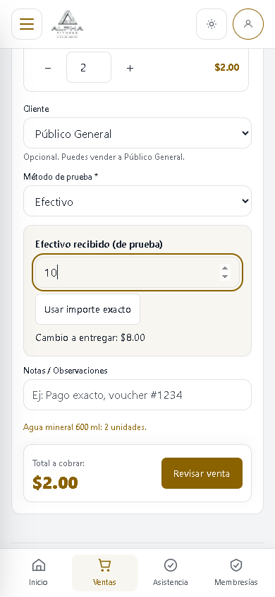
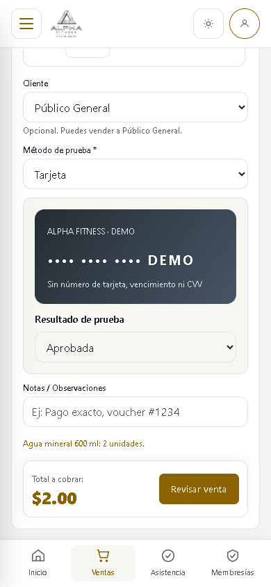
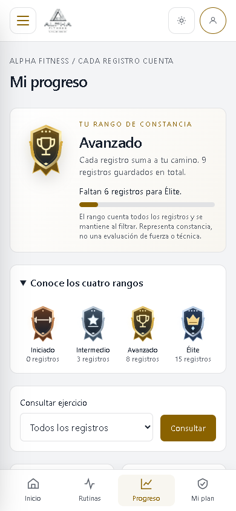
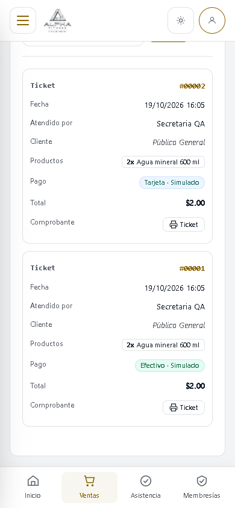

# Alpha Fitness Manual de usuario

**Edición:** 2.0 · **Fecha:** 19 de octubre de 2026

**Revisión de la aplicación:** base `06d31c2` más el árbol de trabajo documentado en `REVISION.json`. Los cambios de esta edición están preparados localmente; este documento no acredita su publicación en GitHub.

**Audiencia:** Administrador, Secretaria, Entrenador y Cliente.

## 1. Propósito y alcance

Este manual explica cómo utilizar Alpha Fitness para administrar cuentas y catálogos, registrar operaciones del gimnasio y consultar el entrenamiento personal. Los procedimientos distinguen los permisos de cada rol y describen los controles visibles en la revisión examinada.

Alpha Fitness es una aplicación web. El usuario debe disponer de la dirección de acceso proporcionada por el responsable del despliegue, conexión al servidor y un navegador con JavaScript y cookies habilitados. No se fija una dirección pública que el proyecto no haya confirmado. Los importes se presentan en dólares estadounidenses, con el símbolo `$` y hasta dos decimales.

Las solicitudes de membresía se pagan en recepción y Secretaria registra su confirmación manual. La pantalla de Ventas funciona en modo de práctica: simula efectivo, tarjeta o transferencia, guarda la venta y descuenta inventario, pero no mueve dinero. Las simulaciones no se suman a los ingresos reales. No introduzca números de tarjeta ni códigos de seguridad. El registro público crea una cuenta de cliente; no contrata ni activa una membresía por sí mismo.

Las instrucciones de instalación, configuración del correo, Google, base de datos y copias de seguridad pertenecen al manual técnico. Este documento se limita a la operación por parte de usuarios y personal autorizado.

**Índice**

1. Propósito y alcance.
2. Perfiles y permisos.
3. Acceso, recuperación y cierre de sesión.
4. Navegación y configuración personal.
5. Procedimientos del Administrador.
6. Procedimientos de la Secretaria.
7. Procedimientos del Entrenador.
8. Procedimientos del Cliente.
9. Incidencias y privacidad.
10. Fuentes y trazabilidad.
11. Glosario.

## 2. Perfiles y permisos

La autorización depende del rol y de que la cuenta esté activa. Una opción puede desaparecer del menú porque el perfil no tiene permiso. Escribir su dirección directamente no concede acceso.

| Función | Admin | Secretaria | Entrenador | Cliente |
| --- | --- | --- | --- | --- |
| Configurar perfil y apariencia | Propios | Propios | Propios | Propios |
| Crear, editar y entrenar rutinas | Propias | Propias | Propias | Propias |
| Consultar y calificar ejercicios activos | Sí | Sí | Sí | Sí |
| Administrar ejercicios, planes y personal | Sí | No | No | No |
| Banear o restaurar clientes | Sí | No | No | No |
| Consultar membresías | Conjunto | Conjunto | No | Propias |
| Solicitar plan | No | No | No | Sí |
| Confirmar cobro y activar plan | No | Sí | No | No |
| Cancelar solicitud pendiente | No | Sí | No | Propia |
| Aprobar o rechazar pausa pendiente | No | Sí | No | No |
| Pausar y reanudar desde la pantalla | Sin botones | Sí | No | Propia |
| Registrar asistencia y exportar CSV | Sí | Sí | No | No |
| Consultar asistencia personal | No aplica | No aplica | No aplica | Sí |
| Administrar productos, ventas y comprobantes | Sí | Sí | No | No |
| Establecer o corregir existencias de productos | Sí | No | No | No |
| Consultar catálogo de productos y entrenadores activos | Sí | Sí | Sí | Sí |
| Consultar y exportar analítica financiera | Sí | No | No | No |
| Asignar una rutina propia a un cliente | Sí | No | Sí | No |
| Consultar marcas deportivas de clientes | Cualquier cliente | No | Con asignación propia | Propias |
| Crear y eliminar marcas deportivas | No | No | No | Propias |

**Matices de la versión.** El Administrador no hereda todas las tareas de recepción: carece del permiso de operaciones de membresías. El servidor admite que solicite una pausa directamente aprobada y que reanude, pero la pantalla no muestra esos botones para su rol. Por ello, el recorrido operativo de pausa se describe para Secretaria y Cliente. La cancelación de una membresía activada tiene una acción de servidor reservada a Secretaria, sin control visible en esta pantalla; no existe un procedimiento ordinario de cancelación desde el menú.

Todos los perfiles autenticados pueden consultar el directorio de entrenadores. El Administrador ve además secretarias y personal inactivo para administrarlo. Los demás perfiles ven entrenadores activos y no sus controles de edición.

## 3. Acceso, recuperación y cierre de sesión

### 3.1. Iniciar sesión como personal

**Objetivo:** ingresar con una cuenta de Administrador, Secretaria o Entrenador. **Precondiciones:** cuenta activa, contraseña ya establecida y correo registrado por el responsable.

1. Abra la dirección del sistema y seleccione la pestaña **Personal**.
2. Introduzca **Correo del personal** y **Contraseña**. El botón **Ver** permite comprobar lo escrito.
3. Pulse **Iniciar Sesión como Usuario**.

**Resultado:** aparece el inicio correspondiente al rol. Si ya había una sesión, el acceso puede abrir directamente el panel. **Recuperación:** ante credenciales incorrectas, compruebe la pestaña, el correo y la contraseña; si persiste, use recuperación. Una cuenta de personal recién invitada no puede entrar hasta establecer su contraseña.

### 3.2. Crear una cuenta de Cliente e ingresar

**Objetivo:** disponer de una cuenta individual. **Precondiciones:** correo propio sin otra cuenta de cliente registrada.

1. Seleccione **Clientes → Crea una cuenta aquí**.
2. Escriba su nombre completo, correo, contraseña y confirmación.
3. Use al menos 12 caracteres, con mayúsculas, minúsculas, número y símbolo.
4. Pulse **Crear cuenta**.

**Resultado:** se crea la cuenta activa y se abre el panel del cliente, sin membresía automática. Para accesos posteriores, seleccione **Clientes**, introduzca correo y contraseña y pulse **Iniciar Sesión como Cliente**. **Recuperación:** si el correo ya existe, recupere esa cuenta; no cree otra con datos de un tercero. Una cuenta desactivada requiere intervención de recepción o del Administrador.

### 3.3. Establecer o recuperar la contraseña

**Objetivo:** restablecer el acceso sin compartir contraseñas. **Precondiciones:** cuenta activa y correo del despliegue preparado para entregar mensajes.

1. Pulse **¿Olvidaste tu contraseña?** en el acceso e introduzca el correo registrado.
2. Pulse **Enviar enlace de recuperación** y revise la bandeja de entrada y correo no deseado.
3. Abra el enlace privado. El formulario **Establecer contraseña** sirve para clientes y personal.
4. Confirme correo y nueva contraseña con los requisitos de la sección 3.2.
5. Pulse **Guardar contraseña** y vuelva a entrar con la pestaña correspondiente.

**Resultado:** la contraseña cambia y las credenciales anteriores dejan de servir. El mensaje de solicitud es deliberadamente genérico; no acredita que exista la cuenta ni que el proveedor haya entregado el correo. **Recuperación:** si el enlace expiró o no es válido, solicite uno nuevo. Si no recibe mensajes, comunique el problema al responsable técnico; no reenvíe enlaces privados a otras personas.

### 3.4. Acceso y vinculación con Google

**Objetivo:** autenticar una cuenta de Cliente mediante Google. **Precondiciones:** integración configurada por el responsable técnico y correo verificado por Google. Su funcionamiento con credenciales reales no se certifica en este manual.

1. En **Clientes**, elija la opción de Google y seleccione su cuenta en el proveedor.
2. Autorice el acceso y espere el retorno a Alpha Fitness.
3. Si ya tiene cuenta local con ese correo, entre primero con contraseña y abra **Configuración → Vincular Google**.
4. Confirme su contraseña actual, pulse **Continuar con Google** y use la misma dirección de correo.

**Resultado:** una identidad nueva puede crear cuenta de cliente; una existente solo se vincula después de la autorización indicada. Tras vincular una cuenta local puede entrar por ambos métodos. **Recuperación:** si Google no está disponible, use correo y contraseña cuando su cuenta disponga de contraseña local. Un correo distinto, no verificado o una cuenta desactivada impide completar el flujo; revise el mensaje o contacte recepción.

### 3.5. Salir y cerrar la sesión

**Objetivo:** finalizar el uso del dispositivo con el efecto adecuado. **Precondición:** sesión abierta.

1. Abra el menú lateral o el menú móvil.
2. Use **Salir** para volver a la información pública del gimnasio conservando la sesión.
3. Use **Cerrar sesión** para invalidar la sesión de Alpha Fitness y regresar al acceso.

**Resultado:** solo **Cerrar sesión** exige autenticar de nuevo al volver. Esta acción no cierra la cuenta de Google en el navegador. **Recuperación:** en equipos compartidos, cierre también su sesión del proveedor si la utilizó y compruebe que Alpha Fitness muestra el acceso.

## 4. Navegación y configuración personal

### 4.1. Reconocer el inicio y el menú

El menú incluye **Inicio**, **Entrenamientos**, **Ejercicios**, **Entrenadores**, **Productos** y **Configuración**, además de las opciones permitidas al rol. En móvil se abre mediante el botón **Abrir menú de navegación**. El perfil del cliente puede aparecer con la etiqueta **Miembro**.

En celulares de menos de 768 píxeles hay una barra inferior con cuatro accesos. Las demás pantallas siguen disponibles en el menú lateral. Los historiales de ventas y membresías se presentan como tarjetas; la pantalla de Progreso también utiliza tarjetas y evita desplazar una tabla ancha.

| Rol | Accesos inferiores |
| --- | --- |
| Administrador | Inicio, Ventas, Clientes y Reportes |
| Secretaria | Inicio, Ventas, Asistencia y Membresías |
| Entrenador | Inicio, Mis clientes, Rutinas y Ejercicios |
| Cliente | Inicio, Rutinas, Progreso y Mi plan |

El inicio del Administrador resume clientes, ingresos, personal y ventas. Secretaria dispone de entradas, personas dentro y solicitudes pendientes. Entrenador ve rutinas propias y ejercicios. Cliente ve rutinas, visitas del mes, membresías y marcas propias. Los avisos de vencimiento muestran períodos cercanos a su fin.

El indicador de aforo utiliza visitas abiertas recientes y una capacidad de referencia de 80 personas. Es un indicador de la aplicación; no bloquea entradas al alcanzar ese valor. El historial de asistencia puede contener visitas abiertas más antiguas que el indicador de aforo excluye.

### 4.2. Actualizar nombre, foto y contraseña

**Objetivo:** mantener la cuenta personal. **Precondición:** sesión del titular.

1. Abra **Configuración → Datos personales**, modifique el nombre y pulse **Guardar perfil**. El correo se muestra como información y no se modifica con este formulario.
2. En **Foto de perfil**, seleccione JPG, PNG o WebP de hasta 2 MB y pulse **Guardar foto**. La imagen debe tener dimensiones máximas de 4096 × 4096 píxeles.
3. En **Seguridad**, indique contraseña actual, nueva contraseña y confirmación; pulse **Actualizar contraseña**.

**Resultado:** nombre y foto se actualizan; el cambio de contraseña renueva el acceso y afecta otras sesiones. Las cuentas que solo usan Google muestran un aviso en lugar del cambio de contraseña. **Recuperación:** corrija formatos, tamaño o contraseña actual según el error; revise el mensaje de confirmación antes de abandonar la página.

### 4.3. Guardar apariencia

**Objetivo:** adaptar la presentación a la cuenta. **Precondición:** sesión abierta.

1. En **Configuración → Apariencia**, seleccione diseño **Elegante** o **Verde**.
2. Elija modo **Claro**, **Oscuro** o **Personalizado**.
3. Si usa Personalizado, ajuste colores principal, acento, fondo, paneles y texto; revise la vista previa.
4. Pulse **Guardar apariencia**. Para volver a la combinación inicial, pulse **Restaurar predeterminados** y luego **Guardar apariencia**.

**Resultado:** la cuenta conserva las preferencias. El botón de tema del menú permite alternar claro y oscuro. **Recuperación:** si falla la validación de contraste, cambie el color de texto, fondo o paneles; se exige un contraste mínimo de 4.5:1 entre texto y esas superficies. Restablecer la vista previa no guarda por sí mismo la elección.

## 5. Procedimientos del Administrador

### 5.1. Crear e invitar personal

**Objetivo:** habilitar empleados con identidad individual. **Precondiciones:** sesión de Administrador y correo válido del empleado.

1. Abra **Entrenadores**, donde dispone de los controles de personal.
2. Complete nombre y correo, seleccione **Entrenador** o **Secretaria** y, si corresponde, adjunte foto.
3. Pulse **Crear e invitar**.
4. Indique al empleado que abra el enlace privado recibido y establezca su contraseña mediante la sección 3.3.

**Resultado:** se crea una cuenta activa pendiente de establecer contraseña. El formulario no permite crear otro Administrador. **Recuperación:** un correo duplicado requiere revisar la cuenta existente. Si la creación informa que debe revisar el correo, la cuenta puede estar creada aunque falle el envío; no repita el alta. El empleado puede solicitar recuperación cuando el servicio de correo esté disponible.

La ficha del empleado muestra su correo y si su acceso está pendiente o preparado. **Reenviar invitación** solo está disponible cuando todavía debe establecer contraseña; respete el tiempo de espera entre envíos. Con correo en modo de prueba, la pantalla advierte que la invitación no se entrega. No comparta enlaces desde logs ni use una contraseña común para todo el personal.

### 5.2. Editar personal y restringir acceso de clientes

**Objetivo:** mantener cuentas sin borrar su historial. **Precondición:** sesión de Administrador.

1. En **Entrenadores**, busque por nombre o correo y filtre rol cuando sea necesario.
2. Abra la edición de la ficha; revise nombre, correo, rol y estado **Activo/Inactivo**.
3. Ajuste foto si corresponde y pulse **Guardar cambios**.
4. Para clientes, abra **Administrar cuentas**, busque al titular y use **Banear usuario** o **Restaurar acceso**, confirmando la acción solicitada.

**Resultado:** un empleado inactivo o cliente baneado pierde acceso; restaurarlo permite entrar de nuevo. La baja conserva historia y no elimina los datos. **Recuperación:** compruebe identidad antes de confirmar. Si el cambio fue incorrecto, vuelva a activar el empleado o restaure al cliente; una contraseña olvidada se recupera por el flujo de acceso.

### 5.3. Configurar planes de membresía

**Objetivo:** ofrecer planes para nuevas solicitudes. **Precondición:** sesión de Administrador.

1. Abra **Membresías → Configuración de Planes de Membresía**.
2. Seleccione crear plan e indique nombre único, precio, duración en días y condiciones.
3. Pulse **Guardar Plan**. Para modificarlo, utilice **Editar** y guarde los cambios.
4. Desactive el plan cuando deje de ofrecerse; puede volver a activarlo.

**Resultado:** los clientes pueden solicitar planes activos. Precio entre $0.01 y $99,999.99, duración entre 1 y 3650 días y condiciones de hasta 255 caracteres. Las solicitudes previas conservan nombre, precio, duración y condiciones capturados al solicitarlas. **Recuperación:** corrija duplicados o campos inválidos; un cambio de catálogo no sustituye los términos guardados de solicitudes anteriores.

### 5.4. Mantener ejercicios del catálogo

**Objetivo:** ofrecer ejercicios disponibles para consulta y rutinas. **Precondición:** sesión de Administrador.

1. Abra **Ejercicios**, busque por nombre o grupo y seleccione añadir o editar.
2. Complete nombre único, grupo muscular y subgrupo opcional.
3. Adjunte, si corresponde, imagen del ejercicio e imagen de músculos; cada archivo admite hasta 8 MB sujeto a la validación de imagen.
4. Guarde y utilice el control de activación/desactivación cuando corresponda.

**Resultado:** un ejercicio activo aparece en el catálogo y se puede añadir a nuevas rutinas. Desactivar no equivale a borrar las referencias históricas. **Recuperación:** corrija nombre duplicado, archivo o tamaño. Una tarjeta sin fotografía sigue mostrando la información disponible; no supone que el registro falte.

### 5.5. Consultar analítica y exportar

**Objetivo:** revisar ingresos registrados. **Precondición:** sesión de Administrador.

1. Abra **Analítica** y elija hoy, ayer, esta semana, semana anterior, este mes o mes anterior.
2. Para un período personalizado, indique ambas fechas y aplique el filtro, con máximo de 90 días incluyendo extremos.
3. Revise ingresos totales, membresías, ventas, ticket promedio, evolución, rendimiento por plan/producto y método o canal.
4. Pulse **Exportar PDF** o **Exportar Excel (.xlsx)** para descargar el período seleccionado.

**Resultado:** se obtienen cifras agregadas; cada exportación registra usuario, tipo y período. El ticket promedio divide ingresos totales entre pagos de membresía y tickets de venta. El período anterior comparado tiene la misma duración. **Recuperación:** corrija fechas invertidas o rangos excesivos. Un período sin movimientos muestra ausencia de actividad. Las cifras reflejan registros del sistema y no una conciliación automática con bancos.

Las ventas identificadas como **Simulada** quedan fuera de importes, conteos de ventas reales, promedios, productos vendidos y distribución por método de estos reportes. Las membresías aportan sus pagos registrados; el precio de un plan sin cobro no acredita un ingreso. En el inicio del Administrador, **Configuración pendiente** informa si falta el correo de entrega, el responsable/contacto de privacidad o la configuración opcional de Google. Solo el Administrador ve ese resumen.

El Administrador también registra asistencia, administra productos y vende mediante los apartados 3 a 5 del capítulo 6. Para crear o asignar rutinas utiliza la sección 7; puede consultar progreso de cualquier cliente activo listado.

## 6. Procedimientos de la Secretaria

### 6.1. Confirmar pago y activar o renovar membresía

**Objetivo:** registrar el pago presencial y su período de servicio. **Precondiciones:** cuenta activa del cliente, solicitud pendiente y cobro comprobado por recepción.

1. Abra **Membresías** y filtre por nombre/correo y estado **Pendiente**.
2. Compruebe cliente, plan, términos guardados y precio acordado.
3. En **Confirmar pago y activar**, indique el **Importe cobrado** y una referencia opcional de hasta 100 caracteres.
4. Pulse **Confirmar pago y activar** y revise vigencia y pago en el historial.

**Resultado:** se conservan cobro, fecha y empleado registrador. El importe real se admite entre $0.01 y $999,999.00 con hasta dos decimales. Una solicitud resuelta no puede cobrarse otra vez. Si hay períodos no cancelados cuyo fin es hoy o posterior, la nueva membresía empieza al día siguiente del último fin; de otro modo empieza hoy. Renovar requiere una nueva solicitud, sin sobrescribir el período anterior.

**Recuperación:** si la solicitud ya está resuelta, revise el historial antes de intentar otro registro. Para una solicitud pendiente que no procede, pulse **Cancelar solicitud** y confirme. No se ofrece en esta pantalla un botón para cancelar una membresía ya activada ni para emitir reembolsos; derive ese caso al responsable de la operación.

### 6.2. Gestionar pausas y reanudación

**Objetivo:** registrar un congelamiento temporal. **Precondiciones:** cliente activo y membresía no cancelada ni vencida.

1. Abra **Membresías** y revise **Solicitudes de Pausa / Congelamiento Pendientes**.
2. Compruebe motivo, inicio, fin previsto y días acumulados; pulse **Aprobar Pausa** o **Rechazar**.
3. Para registrar directamente una pausa de una membresía vigente, pulse **Pausar**, indique fecha de inicio, entre 3 y 30 días y motivo; pulse **Confirmar Pausa**.
4. Para terminar una pausa en curso, pulse **Reanudar** y confirme.

**Resultado:** la solicitud del cliente queda pendiente hasta aprobarse; la pausa introducida por Secretaria se aprueba directamente. Aprobar extiende el vencimiento por los días autorizados. El límite acumulado es de 30 días por membresía; no se admite otra pausa activa o pendiente ni una extensión que se solape con otra membresía no cancelada.

**Recuperación:** corrija fechas fuera de la vigencia o días superiores al saldo. Una pausa pasada o ya resuelta no se aprueba nuevamente. Reanudar en curso ajusta la extensión a días usados, contando el día de reanudación; conserva solo esos días como pausa consumida. La pantalla no presenta el botón Reanudar para anular pausas programadas antes de comenzar, aunque el servidor contempla ese caso; solicite apoyo autorizado para resolverlo.

### 6.3. Registrar entradas, salidas y consultar historial

**Objetivo:** mantener la presencia y visitas. **Precondición:** sesión de Secretaria o Administrador.

1. Abra **Asistencia**, busque al cliente y confirme su identidad.
2. Pulse el control de entrada cuando ingresa; registre la salida al retirarse.
3. Consulte personas dentro, visitas de hoy e historial; filtre fechas, cliente y estado abierto/cerrado.
4. Use la exportación para descargar CSV con los filtros elegidos.
5. Si existen visitas huérfanas, revise la situación y utilice su cierre únicamente cuando corresponda.

**Resultado:** cada visita guarda entrada, salida y operadores. Una visita abierta impide una segunda entrada; una salida requiere una entrada abierta. Cuentas inactivas y pausas aprobadas vigentes bloquean entradas. **La versión no exige membresía vigente para registrar una entrada:** recepción debe comprobar las reglas de admisión del gimnasio por su procedimiento operativo.

**Recuperación:** registre primero la salida si el cliente ya aparece dentro. Las visitas abiertas de más de 12 horas se cierran con una salida estimada de dos horas después de su entrada, tanto en el cierre de huérfanas como al registrar una nueva entrada. Ese horario es una corrección estimada y no la observación de una salida real. Una visita cerrada no dispone de edición ordinaria en esta pantalla.

### 6.4. Administrar productos e inventario

**Objetivo:** mantener el catálogo de mostrador. **Precondición:** sesión de Secretaria o Administrador.

1. Abra **Productos** y busque por nombre o categoría.
2. En **Nuevo producto**, indique nombre, precio, categoría e imagen opcionales; pulse **Guardar producto**. El Administrador también indica el stock entero; Secretaria crea el producto sin establecer existencias.
3. Para modificarlo, abra su edición, ajuste valores y pulse **Guardar cambios**.
4. Desmarque el estado activo para retirarlo de la oferta; conserve el registro histórico.

**Resultado:** los productos activos se ofrecen en el catálogo; solo los activos con stock positivo aparecen para venta. Se admiten precio y stock no negativos hasta 999999; fotos JPG, PNG o WebP de hasta 2 MB. El catálogo pagina cinco productos por página. **Recuperación:** corrija cantidad, precio o imagen. Solo el Administrador puede establecer o corregir existencias; Secretaria puede vender y editar los demás datos permitidos. Confirme el inventario físico antes de reemplazar el stock. La versión no registra un flujo separado de compras a proveedores.

### 6.5. Vender y entregar comprobante

**Objetivo:** practicar una venta de mostrador y descontar existencias. **Precondiciones:** Administrador o Secretaria, productos activos con stock suficiente y un entorno de práctica. Una simulación afecta el inventario registrado; para capacitación use una instalación separada con datos de prueba.

1. Abra **Ventas → Nueva venta**. Busque o filtre los productos por categoría y pulse para añadirlos al carrito.
2. Abra el carrito mediante su acceso en la pantalla. Ajuste cantidades y retire productos incorrectos; cada producto admite hasta 999 unidades acumuladas.
3. Seleccione un cliente activo o deje **Público General**, añada notas opcionales y elija el método de práctica.
4. En **Efectivo**, indique cuánto recibió o use la opción de importe exacto. Por ejemplo, un total de $2.00 con $10.00 recibidos produce $8.00 de cambio. Un importe insuficiente impide confirmar.
5. En **Tarjeta**, la tarjeta virtual **DEMO** permite seleccionar aprobación o rechazo. Un rechazo conserva el formulario y no crea venta ni descuenta inventario. Puede cambiar a aprobación y reintentar.
6. En **Transferencia**, se registra una referencia de simulación sin comunicación con un banco. No se verifica una transferencia real.
7. Revise cliente, productos, total y método en el resumen; confirme la venta una vez.
8. Abra **Ver / Enviar Comprobante** o **Historial y comprobantes**. Use **Imprimir Ticket** o **Enviar por Correo**, revisando el destinatario antes del envío.

**Resultado:** la venta guarda detalle, precios e importe, identifica al vendedor, lleva la etiqueta **Simulada** y descuenta stock. El servidor calcula el total con los precios del catálogo y genera una referencia de simulación; en efectivo guarda recibido y cambio. El comprobante indica que no acredita un pago real y puede imprimirse o guardarse como PDF desde el navegador. El historial permite búsqueda por ticket, cliente, producto o notas, además de fechas y método. Los totales financieros excluyen estas simulaciones.

**Recuperación:** si falta stock, reduzca cantidades o revise el inventario. Ante una respuesta incierta, consulte el historial antes de abrir otra venta; el reintento del mismo formulario conserva su identificador para evitar duplicados, pero un formulario nuevo representa otra operación. Un fallo de correo no elimina la venta. No existe un recorrido ordinario de anulación, devolución o reembolso en esta revisión.

Si el correo está en modo de prueba, **Enviar por Correo** genera el mensaje sin entregarlo y muestra ese límite. Puede imprimir el comprobante mientras el responsable configura un servicio de entrega. Nunca introduzca números de tarjeta, CVV ni contraseñas bancarias en notas o referencias.

## 7. Procedimientos del Entrenador

### 7.1. Construir una rutina propia

**Objetivo:** organizar días y ejercicios. **Precondiciones:** sesión activa y catálogo disponible. El procedimiento también sirve a otros perfiles para sus propias rutinas.

1. Abra **Entrenamientos** y pulse **Crear nueva rutina**.
2. Ajuste nombre, objetivo, nivel y días por semana, entre 1 y 7.
3. Seleccione un día, añada otros si necesita y utilice **Renombrar día** para identificarlos.
4. Busque en **Catálogo de Ejercicios** y pulse `+` para agregar el ejercicio al día seleccionado.
5. Ajuste series, repeticiones, peso en kg y descanso en segundos. Puede ordenar por arrastre y eliminar ejercicios o días, confirmando cuando se solicite.
6. Espere el indicador de guardado y vuelva a **Mis rutinas**. La opción de impresión abre una vista para imprimir o guardar PDF con el navegador.

**Resultado:** el constructor guarda cambios automáticamente; admite de 1 a 20 series, peso de 0 a 999 kg y descanso de 0 a 600 segundos. Las repeticiones son texto y pueden expresarse como un rango. **Recuperación:** revise errores de validación o conexión y compruebe el contenido guardado. Eliminar día borra sus ejercicios; eliminar rutina no se puede deshacer desde la aplicación. Ningún rol obtiene acceso de edición a rutinas ajenas por ser empleado.

### 7.2. Asignar rutina y consultar progreso

**Objetivo:** entregar un plan individual y dar seguimiento. **Precondiciones:** Entrenador o Administrador, rutina propia y cliente activo.

1. En **Entrenamientos**, pulse **Asignar** en la rutina.
2. Seleccione el cliente correcto y pulse **Asignar Rutina**.
3. Para seguimiento, abra **Mis clientes** desde la barra inferior o el directorio, elija un cliente y abra su progreso.
4. Consulte marcas e historial; use el filtro de ejercicio cuando corresponda.

**Resultado:** la asignación copia la rutina, sus días y ejercicios al cliente; no transfiere ni sincroniza la rutina original. El cliente puede modificar su copia. El Entrenador solo consulta progreso cuando existe una rutina atribuida a su identidad; el Administrador puede consultar cualquier cliente. La consulta no permite crear o borrar marcas del cliente.

Cada cliente puede tener rutinas de varios entrenadores; el sistema no presupone un único entrenador titular. En **Entrenadores → Mis entrenadores**, el cliente ve los entrenadores activos que le han asignado rutinas, incluso cuando busca otros nombres en el directorio. El Administrador puede filtrar la lista de clientes por entrenador y revisar quién asignó cada rutina. Las relaciones se basan en el identificador del empleado, no en nombres que podrían coincidir.

**Recuperación:** el selector puede listar clientes a los que el Entrenador aún no tiene acceso; un rechazo exige verificar la asignación. El nombre histórico del asignador no basta para autorizar: asignaciones antiguas sin identidad verificable requieren revisión. No repita una asignación para resolver un error de navegación sin comprobar las copias ya creadas.

## 8. Procedimientos del Cliente

### 8.1. Solicitar membresía y revisar vigencia

**Objetivo:** pedir un plan y consultar su estado. **Precondición:** cuenta activa de Cliente.

1. Abra **Membresías**, revise precio, duración y condiciones del plan activo.
2. Pulse **Solicitar este plan**.
3. Acuda a recepción para el pago presencial y su confirmación por Secretaria.
4. Revise solicitud, vigencia, estado e importe en el historial.

**Resultado:** solicitar genera un registro pendiente; solo la confirmación de recepción lo activa. Los estados de membresía pueden ser Programada, Vigente, En Pausa, Vencida o Cancelada. Para renovar, solicite otro período; las fechas pagadas se conservan. **Recuperación:** si ya hay solicitud pendiente del mismo plan, consúltela o cancele mediante **Cancelar solicitud** antes de reemplazarla. Los datos de otros clientes no aparecen en esta consulta.

### 8.2. Solicitar pausa y reanudar

**Objetivo:** suspender temporalmente una membresía propia. **Precondición:** período vigente elegible, sin otra pausa pendiente o activa y saldo de días disponible.

1. En el historial de **Membresías**, pulse **Pausar**.
2. Introduzca fecha de inicio desde hoy y dentro del período, entre 3 y 30 días y motivo breve.
3. Pulse **Confirmar Pausa** y espere aprobación de recepción.
4. Cuando la pausa esté en curso y desee volver, pulse **Reanudar** y confirme.

**Resultado:** el estado pendiente no congela todavía el acceso; aprobar extiende el vencimiento y una pausa vigente bloquea entradas. El límite de 30 días es acumulado por membresía. **Recuperación:** contacte recepción si necesita corregir una solicitud pendiente o anular una pausa futura; la pantalla no ofrece todos esos controles. No introduzca diagnóstico ni documentación médica sensible en el motivo: basta una referencia operativa.

### 8.3. Entrenar y guardar la sesión

**Objetivo:** seguir una rutina propia o asignada y registrar la actividad. **Precondiciones:** rutina propia con días y ejercicios, JavaScript y conexión para guardar.

1. Abra **Entrenamientos**, elija la rutina y pulse **Entrenar**.
2. Seleccione el día y marque las series completadas.
3. Utilice el temporizador de descanso: iniciar, pausar, reiniciar o elegir duración. Active o silencie sonido y vibración según el dispositivo.
4. Pulse **Finalizar Entrenamiento** y espere **¡Entrenamiento registrado!**.
5. Abra el historial desde Entrenamientos o desde el resumen; compruebe sesión, fecha, duración y series.

**Resultado:** el historial conserva sesiones y resume sesiones, minutos y series completadas. Puede guardar una sesión con parte de las series realizadas; finalizar no exige completar el 100 %. Las marcas de peso de Progreso se registran aparte.

**Recuperación:** un error de guardado no acredita registro; mantenga la página y reintente tras recuperar conexión. El identificador de esa página evita otra sesión por el mismo reintento. Al recargar se crea otro identificador: revise primero el historial si la respuesta fue incierta. Las series marcadas y el cronómetro de la sesión en curso no tienen persistencia comprobada tras recargar; la preferencia de sonido sí se guarda cuando el navegador lo permite. Sonido y vibración dependen de compatibilidad y permisos del navegador.

### 8.4. Registrar marcas y consultar asistencia

**Objetivo:** revisar el progreso personal y las visitas. **Precondición:** sesión del Cliente.

1. Abra **Progreso → Registrar levantamiento**.
2. Seleccione ejercicio activo, peso entre 0.5 y 999 kg, de 1 a 100 repeticiones y notas opcionales.
3. Guarde y revise el historial; filtre por ejercicio o elimine un registro propio erróneo confirmando la acción.
4. Abra **Mi Asistencia** para consultar total de visitas, visita abierta e historial de entradas y salidas.

**Resultado:** Progreso calcula volumen como peso × repeticiones, destaca una mejor serie por ejercicio y muestra levantamientos recientes. El máximo de peso y la mejor serie por volumen representan medidas distintas. La gráfica compara hasta ocho registros del mismo ejercicio en orden temporal; requiere al menos dos. El filtro permite revisar también un ejercicio archivado si ya tiene registros propios. Mi Asistencia es de consulta; recepción registra las entradas y salidas.

El rango representa la constancia de registro y usa todos los levantamientos guardados, incluso al filtrar o cambiar de página. Las cuatro insignias son imágenes propias del proyecto. No evalúa fuerza, técnica ni salud, y completar una sesión de entrenamiento no crea automáticamente una marca.

| Rango | Registros guardados |
| --- | --- |
| Iniciado | De 0 a 2 |
| Intermedio | De 3 a 7 |
| Avanzado | De 8 a 14 |
| Élite | Desde 15 |

La pantalla indica cuántos registros faltan para el siguiente rango. Eliminar una marca errónea actualiza resumen y rango, por lo que puede bajar de nivel. **Recuperación:** si hay una visita incorrecta, contacte recepción; para corregir una marca, elimine únicamente su registro y vuelva a crearlo. No hay edición directa del peso de un registro existente.

### 8.5. Consultar y calificar ejercicios

**Objetivo:** localizar ejercicios y expresar una valoración. **Precondición:** sesión activa; disponible para todos los roles.

1. Abra **Ejercicios**, busque por nombre o filtre grupo muscular.
2. Revise la tarjeta y seleccione de una a cinco estrellas.
3. Compruebe su calificación, promedio y cantidad de votos; cambie las estrellas si desea actualizar su voto.

**Resultado:** se mantiene una valoración por cuenta y ejercicio. El orden usa promedio de estrellas, cantidad de votos y nombre; la etiqueta de populares no implica que se descarten votos de semanas anteriores. **Recuperación:** un ejercicio desactivado ya no se califica; revise conexión o actualice la consulta si cambió su disponibilidad.

## 9. Incidencias y privacidad

### 9.1. Respuesta ante incidencias

| Situación | Acción del usuario |
| --- | --- |
| Acceso rechazado o cuenta inactiva | Revise pestaña y credenciales; recepción y Administrador verifican el estado. |
| Enlace de contraseña inválido | Solicite otro enlace y abra el más reciente. |
| Correo no recibido | Revise spam y dirección; comunique el problema al responsable del correo. |
| Sesión expirada o error 419 | Entre nuevamente y compruebe si se registró la operación antes de repetirla. |
| Error 403 | Verifique rol, titularidad de rutina o asignación; no fuerce acceso. |
| Error 404 | Vuelva al listado; el recurso puede haber cambiado o no estar disponible. |
| Demasiados intentos o error 429 | Espere el intervalo indicado y reintente sin envíos repetitivos. |
| Error de servidor o 500 | Registre hora, módulo y acción; informe a soporte sin incluir contraseñas. |
| Pantalla sin datos | Limpie filtros y revise paginación; el catálogo o historial puede estar vacío. |
| Venta o sesión con respuesta incierta | Revise historial antes de iniciar una nueva operación. |

Al informar una incidencia, proporcione rol, módulo, mensaje visible, hora aproximada y número de ticket o recurso cuando exista. Evite enviar capturas con datos de otras personas, enlaces de recuperación, credenciales o información médica. No se asigna en este manual un teléfono o correo de soporte que el despliegue no haya confirmado.

### 9.2. Uso y conservación de datos

La página pública **Política de privacidad**, en `/privacidad`, describe cuenta, Google, membresías, asistencia, entrenamiento y operaciones registradas. El responsable y contacto de privacidad dependen de la configuración del gimnasio; si aparecen pendientes, presente la solicitud en recepción.

Las cuentas usan su propia información y el personal consulta lo autorizado por su función. La analítica exporta cifras agregadas, mientras que comprobantes e informes de asistencia pueden contener información identificable: entréguelos únicamente al destinatario correcto. Los avatares publicados son imágenes de perfil; no suba documentos privados. Banear o desactivar no equivale a eliminar historia.

La aplicación utiliza cookies de sesión y preferencias de navegador. El servidor contempla Recordarme, pero la pantalla de acceso examinada no ofrece esa casilla. Puede solicitar al responsable acceso, corrección o eliminación de datos, atendiendo la conservación operativa que corresponda. No hay una pantalla de eliminación automática de toda la cuenta o del historial financiero; plazos y solicitudes los debe definir el responsable. Este manual describe el software y no certifica cumplimiento legal de un despliegue.

## 10. Fuentes y trazabilidad

### 10.1. Revisión y comprobaciones

Esta edición se contrastó con rutas, permisos, controladores, modelos, servicios y vistas del árbol de trabajo del 19 de octubre de 2026. `REVISION.json` conserva la base y las huellas del contenido documentado; los resultados y límites se detallan en `VERIFICACION_PRUEBAS.md`.

La revisión funcional ejecutó 234 pruebas con 1842 aserciones, ocho grupos de regresión de JavaScript y recorridos de navegador de los cuatro roles. Utilizó SQLite aislado y datos sintéticos. Se comprobaron ventas simuladas con cambio, rechazo y reintento; progreso por ejercicio; relaciones entrenador-cliente; permisos, vistas móviles y recursos compilados. Estas comprobaciones no acreditan cobros bancarios, entrega SMTP, Google real, concurrencia MySQL ni un dispositivo iOS físico.

Los ejemplos y capturas de esta edición utilizan datos de prueba. La migración de pagos simulados se aplicó además a la base local tras crear y comprobar un respaldo consistente; las ventas históricas conservaron su clasificación y no se crearon ventas de práctica en esa base para tomar capturas.

### 10.2. Referencias para mantener el manual

| Función | Fuente y pruebas principales |
| --- | --- |
| Roles y navegación | `app/Support/Acceso.php`, `partials/sidebar`, `partials/mobile-nav`; `AdminPermisosTest`, `ProgresoMovilTest`. |
| Acceso, invitación y recuperación | Controladores `Auth`, `EntrenadorController`, `Invitaciones`; `PasswordResetIsolationTest`, `AccesoEntrenadoresTest`, `GestionPersonalTest`, `GoogleTest`. |
| Perfil y apariencia | `ConfiguracionController`, `Apariencia`; `AparienciaTest`. |
| Planes, cobros y pausas | `MembresiaController`, `PlanMembresiaController`; `PlanesMembresiaTest`, `MembresiasTest`, `PausaRenovacionIntegridadTest`. |
| Visitas | `AsistenciaController`, `RegistroAsistencia`; `AsistenciaClienteTest`, `AsistenciaExportSeguridadTest`. |
| Productos y ventas | `ProductoController`, `VentaController`, `PagoSimulado`; `ProductosPermisosTest`, `PagosSimuladosTest`, `VentaIntegridadTest`, `ComprobanteVentaTest`. |
| Reportes | `AnaliticaFinancieraService` y servicios de exportación; `AnaliticaFinancieraTest`, `ReporteExcelSeguridadTest`, `ReportesGerencialesTest`. |
| Rutinas y sesiones | `RutinaController`, vistas `entrenamientos`; `RutinasAvanzadasTest`, `SesionEntrenamientoTest`, `SesionUuidNormalizacionTest`. |
| Clientes del entrenador y progreso | `ClientesEntrenador`, `ProgresoCliente`, `RangoAtleta`; `AccesoEntrenadoresTest`, `ProgresoEntrenadorTest`, `ProgresoMovilTest`. |
| Privacidad y protección general | Vista `privacidad`, middlewares y configuración; `SeguridadTest`, `HardeningRegressionTest`, `IntegridadFinancieraPrivacidadTest`. |

Los controladores están en `app/Http/Controllers/`, los servicios en `app/Services/`, los soportes en `app/Support/`, las vistas en `resources/views/` y las pruebas citadas en `tests/Feature/`.

### 10.3. Límites operativos

Hay acciones de servidor sin controles ordinarios visibles para cancelar una membresía activada o anular una pausa futura. Este manual no inventa botones para ellas. No existe una pantalla de reembolso o devolución de ventas, ni un historial formal de compras a proveedores.

Las series marcadas durante una sesión abierta pueden perderse al recargar; solo una finalización confirmada guarda la sesión en la base de datos. Las invitaciones y comprobantes no se entregan mientras el correo siga en modo de prueba. La publicación requiere completar responsable y contacto de privacidad; Google sigue siendo opcional.

## 11. Glosario

| Término | Significado en Alpha Fitness |
| --- | --- |
| Cliente / Miembro | Titular de una cuenta de cliente; no implica membresía vigente. |
| Personal | Cuenta de Administrador, Secretaria o Entrenador. |
| Plan | Oferta de precio, duración y condiciones para solicitar membresía. |
| Solicitud | Petición del cliente, pendiente hasta resolución de recepción. |
| Membresía | Período activado tras registrar pago presencial. |
| Pausa / Congelamiento | Suspensión temporal aprobada que ajusta el vencimiento. |
| Visita abierta / huérfana | Entrada sin salida; huérfana si supera 12 horas en las reglas de cierre. |
| Rutina / Día / Serie | Plan de ejercicios, agrupación de entrenamiento y unidad de ejecución. |
| Marca personal / PR | Registro de peso y repeticiones realizado por el cliente. |
| TPV / Ticket | Punto de venta de mostrador y comprobante de una venta. |
| Stock | Cantidad de producto disponible registrada en inventario. |
| SMTP / OAuth | Servicio de entrega de correo / autorización usada para el acceso con Google. |
| Reintento | Nuevo envío de la misma operación; su identificador evita duplicarla dentro del flujo previsto. |
