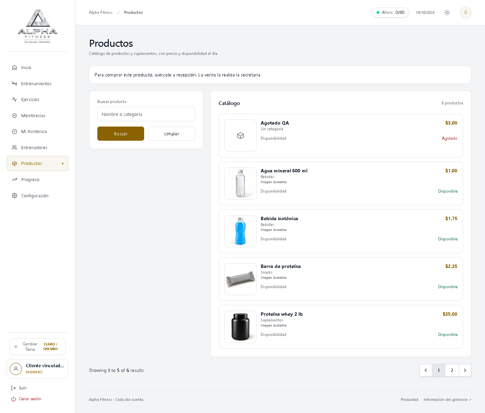
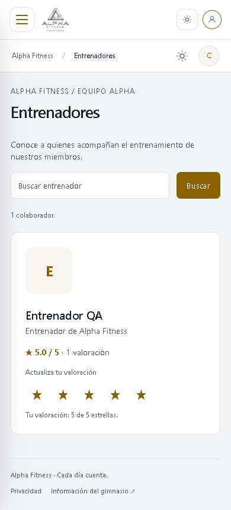
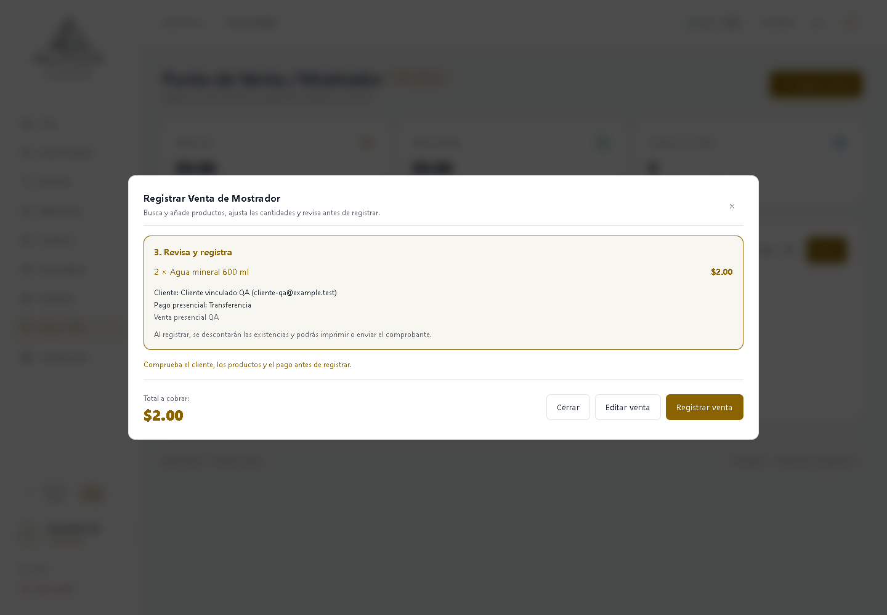

# Mejoras de Productos Punto de Venta y Entrenadores de Alpha Fitness

**Fecha:** 14 de octubre de 2026.\
**Audiencia:** presentación del proyecto y revisión de sus módulos.\
**Estado:** documentación contrastada con el código; `VERIFICADO_CON_LIMITES`.\
**Versión examinada:** base Git `db338cd0b67410baf61ad7459f91a34a61a92ad8` más cambios locales. El SHA de la base no identifica por sí solo esta entrega: el snapshot de 35 archivos tiene huella SHA-256 `c9bb7e6fded081081178c1ca2527a9665445fb3e8ac0b56da9857aa7385d9dd2`.

Alpha Fitness presenta un catálogo para consultar productos, registra ventas presenciales y permite al entrenador seguir a los clientes a quienes ha asignado rutinas. Las mejoras distinguen permisos por perfil, revisan la venta antes de guardarla y permiten actualizar una valoración sin crear votos repetidos.

## Contenido

- [Propósito y alcance](#propósito-y-alcance)
- [Resultados presentables](#resultados-presentables)
- [Permisos de los módulos](#permisos-de-los-módulos)
- [Guion de demostración](#guion-de-demostración)
- [Evidencia y límites](#evidencia-y-límites)
- [Fuentes de la versión](#fuentes-de-la-versión)

## Propósito y alcance

El trabajo mejora cuatro flujos relacionados: consulta del catálogo, gestión de productos y existencias, registro de ventas en recepción y seguimiento del entrenamiento. El sistema utiliza Laravel 12, PHP compatible con `^8.2`, vistas Blade y recursos frontend compilados con Vite. La comprobación anterior se realizó con SQLite local.

Esta presentación describe lo implementado en esos módulos. No certifica una instalación de Antigravity ni todos los servicios externos de la aplicación. Las instrucciones para operar los módulos están en [Guía de uso](GUIA_USO_MODULOS.md).

## Resultados presentables

| Área | Comportamiento de la versión examinada | Beneficio observable |
| --- | --- | --- |
| Productos | Búsqueda por nombre o categoría; precio, imagen y disponibilidad; cinco ilustraciones WebP locales para productos existentes | El cliente consulta el catálogo y recibe la indicación de comprar en recepción |
| Gestión del catálogo | Administrador y Secretaria crean o editan productos; únicamente el Administrador establece existencias manualmente | La edición comercial no permite a Secretaria modificar cantidades directamente |
| Punto de Venta | Búsqueda, productos agrupados, ajuste de cantidades, selección de cliente y pago presencial, revisión y registro | El operador comprueba la venta antes de guardarla |
| Integridad de ventas | Total calculado en el servidor, validación de existencias, transacción y UUID de reintento | Un reenvío con la misma identidad devuelve la venta existente al mismo operador |
| Recuperación de errores | Tras un error de validación se conservan productos, cantidades, cliente, método, notas y UUID | El operador corrige la venta sin reconstruir todos los campos |
| Entrenadores | Directorio buscable, promedio y cantidad de valoraciones; cliente vinculado puede calificar de 1 a 5 estrellas | El cliente actualiza su valoración y se mantiene un voto por pareja cliente-entrenador |
| Mis clientes | Lista sin repetir clientes, búsqueda, rutinas asignadas y acceso autorizado a progreso | El entrenador encuentra a sus clientes y consulta sus registros de entrenamiento |

Se corrigieron también el envío del valor seleccionado en las estrellas, el tratamiento de búsquedas con el texto `0` y la visibilidad de los botones correspondientes a edición y revisión de la venta.

Las ilustraciones de catálogo están identificadas como **Imagen ilustrativa**. Representan productos; no sustituyen una fotografía del artículo real ni una captura del sistema.

Estas capturas proceden de la validación anterior con datos ficticios; muestran pantallas reales de la aplicación.

*Figura 1. El cliente consulta precio y disponibilidad, con la indicación de comprar en recepción.*

*Figura 2. El directorio adapta las tarjetas y los controles de valoración a una pantalla móvil.*

*Figura 3. La revisión permite comprobar productos, cliente, pago y total antes del registro.*

## Permisos de los módulos

La matriz se limita al alcance de esta presentación. Requiere una sesión válida y una cuenta activa.

| Función | Administrador | Secretaria | Entrenador | Cliente |
| --- | --- | --- | --- | --- |
| Consultar Productos | Todos, incluidos inactivos; cantidades exactas | Todos, incluidos inactivos; cantidades exactas | Activos; Disponible/Agotado | Activos; Disponible/Agotado |
| Crear y editar productos | Sí | Sí; creación con existencias iniciales en cero | No | No |
| Ajustar existencias manualmente | Sí | No | No | No |
| Registrar ventas y consultar comprobantes | Sí | Sí | No | No |
| Consultar el directorio de entrenadores | Sí; también gestión de personal | Entrenadores activos | Entrenadores activos | Entrenadores activos |
| Crear o editar personal | Sí | No | No | No |
| Calificar a un entrenador | No | No | No | Sí, si está activo y le asignó una rutina |
| Consultar clientes, rutinas y progreso desde el seguimiento | Todos los clientes | No | Clientes con alguna rutina asignada por él | No; utiliza su propio módulo Progreso |

La vinculación cliente-entrenador procede de las rutinas asignadas al cliente. Las rutinas archivadas también cuentan mientras exista la asignación. Eliminar la última asignación del entrenador revoca el acceso de seguimiento y la autorización para emitir o actualizar la valoración; no elimina automáticamente una valoración anterior.

El acceso administrativo de seguimiento existe en `/entrenador/clientes`, con el título **Clientes y progreso**. El enlace **Mis clientes** del menú aparece para el perfil Entrenador. La vista de seguimiento contiene datos de entrenamiento y no muestra información financiera.

## Guion de demostración

**Duración sugerida: 6 minutos.** Es una propuesta de exposición, no una ejecución adicional de pruebas. Preparar una copia de demostración con datos ficticios, un producto activo con existencias, una cuenta por perfil y un cliente con rutina asignada por el entrenador. Confirmar el contenido antes de compartir pantalla.

| Tiempo sugerido | Acción | Idea que se explica |
| --- | --- | --- |
| 0:00–0:40 | Presentar el objetivo y los cuatro perfiles | Cada perfil realiza tareas concretas según sus permisos |
| 0:40–1:25 | Como Cliente, abrir Productos y buscar por categoría | Mostrar imagen, precio y Disponible/Agotado; la compra se realiza en recepción |
| 1:25–2:00 | Como Secretaria, abrir la edición de un producto | Mostrar campos comerciales y explicar que el ajuste manual de existencias corresponde al Administrador |
| 2:00–3:40 | Abrir Ventas (TPV), añadir dos veces el mismo producto, ajustar cantidad y pulsar Revisar venta | Mostrar una línea agrupada, el total y los datos del pago presencial; usar Editar venta para corregir y registrar una sola vez |
| 3:40–4:20 | Abrir el comprobante de la venta registrada y localizarla en el historial | Mostrar la correspondencia entre productos, cantidades y total; explicar la protección de reintentos |
| 4:20–5:05 | Como Cliente vinculado, abrir Entrenadores, elegir estrellas y actualizar la selección | El promedio cambia; actualizar no añade un segundo voto del mismo cliente |
| 5:05–5:45 | Como Entrenador, abrir Mis clientes, buscar al cliente y entrar a Ver rutinas y Ver progreso | El acceso depende de sus asignaciones; el progreso muestra marcas e historial |
| 5:45–6:00 | Exponer evidencia y límites | Las pruebas locales respaldan estos recorridos; quedan servicios externos y concurrencia real por comprobar |

En la exposición, limitar las modificaciones a datos ficticios. Si el entorno no permite registrar una venta de demostración, mostrar el recorrido hasta **Revisar venta** y un comprobante ficticio ya existente. Presentarlo como demostración parcial.

## Evidencia y límites

Las siguientes cifras proceden de la validación de implementación anterior comunicada por el coordinador. La creación de estos documentos no ejecutó nuevamente pruebas del sistema ni modificó la base de datos.

| Verificación anterior | Resultado comunicado | Alcance de la evidencia |
| --- | --- | --- |
| PHPUnit, suite general | 214 pruebas; 1,653 aserciones; código de salida 0 | Regresión general en el entorno de pruebas |
| Revalidación de Productos, permisos y Entrenadores tras el ajuste de búsqueda `0` | 29 pruebas; 235 aserciones; código de salida 0 | Pruebas afectadas por el ajuste posterior; se solapan con la suite general |
| Revisión independiente de pruebas pertinentes | 50 pruebas; 365 aserciones; código de salida 0 | Ejecución adicional con casos que se solapan; no sumar como pruebas distintas |
| Comprobación frontend | 8 grupos; código de salida 0 | Regresión del comportamiento frontend contemplado por el script |
| Navegador, recorrido completo | 5 grupos; sin errores JavaScript registrados | Catálogo, estrellas, Mis clientes y POS, en 1440×1000 y 390×844 |
| Navegador, revalidación POS tras el ajuste de estilos | 2 grupos; sin errores JavaScript registrados | Registro, reintento, recuperación de error, móvil, teclado y Escape |
| Base SQLite local | Respaldo antes de dos migraciones; comprobaciones sin referencias rotas, stock negativo o valoraciones inválidas/duplicadas; totales coherentes | Estado inspeccionado en esa ejecución; las existencias se conservaron |

Los resultados de navegador y sus tamaños se contrastaron directamente con los archivos privados de resultados de QA. No se incluyen aquí credenciales, respaldos, datos reales ni logs.

Los comandos siguientes identifican las ejecuciones anteriores. No se ejecutaron para redactar estos documentos. Los recorridos de navegador requieren el entorno aislado de QA correspondiente; esta tabla no es una instrucción para ejecutarlos contra datos reales.

| Ejecución | Comando registrado, desde la raíz del proyecto |
| --- | --- |
| PHPUnit general | `C:/xampp/php/php.exe vendor/phpunit/phpunit/phpunit --do-not-cache-result` |
| Revalidación de 29 pruebas | `C:/xampp/php/php.exe vendor/phpunit/phpunit/phpunit --filter 'ProductosTest\|ProductosPermisosTest\|EntrenadoresTest' --do-not-cache-result` |
| Revisión de 50 pruebas | `C:/xampp/php/php.exe vendor/phpunit/phpunit/phpunit --filter 'ProductosPermisosTest\|PuntoVentaTest\|EntrenadoresTest\|ProgresoEntrenadorTest\|VentaIntegridadTest\|ComprobanteVentaTest'` |
| Frontend, 8 grupos | `node tools/frontend_regression_check.cjs` |
| Navegador, 5 grupos | `node tools/modules_browser_check.cjs` |
| Navegador POS, 2 grupos | `node tools/modules_browser_check.cjs --pos-only` |
| Compilación de recursos | `npm run build` y, en la última ejecución, `node node_modules/vite/bin/vite.js build`; ambos con salida 0 |

**No probado:** concurrencia real entre varios operadores, entrega por SMTP real e impresión en una impresora física. La protección de reintentos tiene pruebas funcionales y revisión de implementación; esto no demuestra por sí solo todos los comportamientos de un motor de base de datos bajo concurrencia. Una pantalla de comprobante o un correo simulado tampoco demuestra la entrega externa.

La evidencia está ligada a las fuentes y al contexto examinados. Cambios posteriores en código, configuración, datos de prueba o runtime requieren revalidar las comprobaciones afectadas. Este documento no promete ausencia total de errores.

## Fuentes de la versión

Las rutas siguientes se resuelven desde la carpeta de este documento y se contrastaron por lectura. La matriz conecta comportamiento, implementación y evidencia existente.

| Función documentada | Fuente de implementación | Comprobación existente |
| --- | --- | --- |
| Catálogo y existencias | [ProductoController.php](../../app/Http/Controllers/ProductoController.php), [vista Productos](../../resources/views/productos/index.blade.php), [Acceso.php](../../app/Support/Acceso.php) | [ProductosPermisosTest.php](../../tests/Feature/ProductosPermisosTest.php), [ProductosTest.php](../../tests/Feature/ProductosTest.php) |
| Imágenes del catálogo | [ImagenesCatalogo.php](../../app/Support/ImagenesCatalogo.php), [migración de asociación](../../database/migrations/2026_10_14_100000_associate_catalog_product_images.php) | Verificación anterior de las cinco imágenes locales |
| Registro y recuperación de venta | [VentaController.php](../../app/Http/Controllers/VentaController.php), [ventas.js](../../resources/js/ventas.js), [vista POS](../../resources/views/ventas/index.blade.php) | [PuntoVentaTest.php](../../tests/Feature/PuntoVentaTest.php), [VentasTest.php](../../tests/Feature/VentasTest.php), resultados de navegador |
| Valoraciones | [EntrenadorController.php](../../app/Http/Controllers/EntrenadorController.php), [vista Entrenadores](../../resources/views/entrenadores/index.blade.php), [migración de calificaciones](../../database/migrations/2026_10_14_120000_create_entrenador_calificaciones_table.php) | [EntrenadoresTest.php](../../tests/Feature/EntrenadoresTest.php) |
| Vinculación y seguimiento | [ClientesEntrenador.php](../../app/Services/ClientesEntrenador.php), [ProgresoController.php](../../app/Http/Controllers/ProgresoController.php), [vista Mis clientes](../../resources/views/entrenador/clientes.blade.php) | [ProgresoEntrenadorTest.php](../../tests/Feature/ProgresoEntrenadorTest.php) |
| Acceso y navegación | [rutas web](../../routes/web.php), [menú lateral](../../resources/views/partials/sidebar.blade.php), [AppServiceProvider.php](../../app/Providers/AppServiceProvider.php) | Pruebas de permisos y solicitudes a rutas directas |
| Pila del proyecto | [composer.json](../../composer.json), [package.json](../../package.json) | Lectura de manifiestos; no se reinstalaron dependencias para redactar |

**Vocabulario:** TPV significa Punto de Venta; existencias son las unidades registradas de un producto; valoración es el voto de 1 a 5 estrellas; vinculación es la relación derivada de una rutina asignada; UUID es el identificador que conserva una venta durante un reintento.
